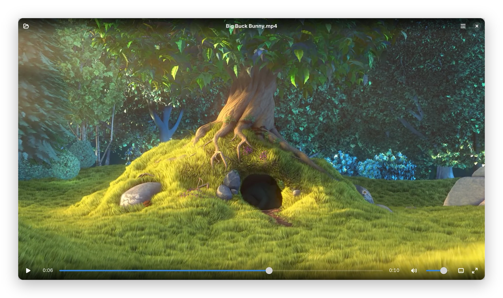

<div align="center">


# Reel

**A simple, fast video and music player for Linux, with AI subtitles that run on your own PC.**

No clutter, no watch history. Plays almost anything, uses your GPU for decoding, and can write
subtitles for any video with Whisper. Nothing is uploaded.

[](LICENSE)


[](https://github.com/voidrlm/reel/releases)

[Install](#install) · [Features](#features) · [AI subtitles](#ai-subtitles) · [Mouse & keys](#mouse-keyboard-and-gamepad) · [FAQ](#faq)



<sub>Big Buck Bunny © Blender Foundation, CC BY 3.0</sub>

</div>

## Install

Paste this into a terminal:

```sh
curl -fsSL https://raw.githubusercontent.com/voidrlm/reel/main/install.sh | bash
```

Reel appears in your app grid. To also make it your **default player** for videos and music:

```sh
curl -fsSL https://raw.githubusercontent.com/voidrlm/reel/main/install.sh | bash -s -- --default
```

The installer adds the GStreamer packages Reel needs (it asks for your password once), installs Reel
for your user only in `~/.local/opt/reel`, and updates it when you run it again.

**Runs on:** Fedora 43+, Ubuntu 25.10+, Arch Linux and other distributions with libadwaita 1.8 or newer.

<details>
<summary>Other ways to install</summary>

**From a clone:**

```sh
git clone https://github.com/voidrlm/reel.git
cd reel && ./install.sh            # add --default to make it the default player
```

**By hand:** install these, then run `./reel`.

| Distribution | Packages |
|---|---|
| Fedora | `sudo dnf install python3-gobject gtk4 libadwaita gstreamer1-plugin-gtk4 gstreamer1-plugins-good gstreamer1-plugins-bad-free gstreamer1-plugin-libav libmanette` |
| Ubuntu / Debian | `sudo apt install python3-gi gir1.2-gtk-4.0 gir1.2-adw-1 gir1.2-gstreamer-1.0 gir1.2-gst-plugins-base-1.0 gstreamer1.0-gtk4 gstreamer1.0-plugins-good gstreamer1.0-plugins-bad gstreamer1.0-libav gir1.2-manette-0.2` |
| Arch | `sudo pacman -S python-gobject gtk4 libadwaita gst-plugin-gtk4 gst-plugins-good gst-plugins-bad gst-libav libmanette` |

</details>

## Features

- **Plays almost anything:** MP4, MKV, WebM, AVI, MOV, MP3, FLAC, Opus and more, plus network streams (HTTP, HLS, RTSP).
- **Hardware decoding** through VA-API (H.264, H.265, VP9, AV1) when your GPU supports it, so it stays cool and quiet.
- **Out of your way:** the controls fade while a video plays, and the window fits the video's shape.
- **YouTube-style mouse gestures:** double-click the sides to skip 10 s, hold to fast-forward or rewind. [Details below](#mouse-keyboard-and-gamepad).
- **Subtitles:** embedded tracks, `.srt` files (a matching one next to the video loads by itself), or [generated with AI](#ai-subtitles). Change the font, size, colour, outline and position with a live preview, and nudge the timing with <kbd>G</kbd> / <kbd>H</kbd>.
- **Audio tracks and speed** from 0.5× to 2× without chipmunk voices.
- **Folder playback:** next and previous walk through the other videos in the same folder.
- **Gamepad support** for Xbox, PlayStation, Switch and generic controllers.
- **No watch history.** Reel doesn't remember what you watched.

## AI subtitles

Open the **Subtitles** menu → **Generate with AI…** on any video without subtitles.

- **Runs entirely on your computer** with [whisper.cpp](https://github.com/ggml-org/whisper.cpp). No account, no upload, no cost.
- **Picks the right model for your PC** from its cores, memory and CPU features (AVX2/AVX-512/NEON), and steps down by itself if your PC can't keep ahead of playback.
- **Starts where you are watching:** the minutes around the playback position are done first, and it follows you when you seek.
- **Can translate** speech in any language into English subtitles.
- Results are cached per video, so reopening a video shows its subtitles instantly.

The first time, Reel builds whisper.cpp for your CPU (installing a compiler if needed, which asks for
your password) and downloads the model. Only one AI job ever runs at a time, and it stops when Reel closes.

## Mouse, keyboard and gamepad

**Mouse:** click the middle of the video to play or pause, and double-click it for fullscreen.
Double-click the left or right third to skip back or forward 10 s; each further quick click adds 10 s.
**Hold** the right side to fast-forward (2×, then 4×) or the left side to rewind. Scroll to change the volume.

**Keys:**

| Key | Action | Key | Action |
|---|---|---|---|
| <kbd>Space</kbd> | Play / pause | <kbd>F</kbd> | Fullscreen |
| <kbd>←</kbd> <kbd>→</kbd> | 10 s (<kbd>Shift</kbd> 3 s, <kbd>Ctrl</kbd> 1 min) | <kbd>M</kbd> | Mute |
| <kbd>↑</kbd> <kbd>↓</kbd> | Volume | <kbd>S</kbd> / <kbd>A</kbd> | Subtitle / audio track |
| <kbd>[</kbd> <kbd>]</kbd> | Speed | <kbd>G</kbd> / <kbd>H</kbd> | Subtitle timing |
| <kbd>N</kbd> / <kbd>P</kbd> | Next / previous | <kbd>0</kbd>–<kbd>9</kbd> | Jump to 0–90 % |
| <kbd>Ctrl</kbd>+<kbd>O</kbd> | Open file | <kbd>Ctrl</kbd>+<kbd>L</kbd> | Open stream URL |

**Gamepad:** A / ✕ play-pause · Y / △ fullscreen · B / ○ leave fullscreen · X / □ next subtitle ·
Select next audio track · D-pad or left stick: seek and volume · LB / RB previous / next video ·
hold LT / RT to rewind / fast-forward. Works with any controller libmanette knows, only while Reel is focused.

## Command line

```sh
reel video.mkv
reel https://example.com/stream.m3u8
reel movie.mp4 --sub-file=movie.en.srt --title="My Movie"
```

## FAQ

**A video plays without sound or picture.**
You're probably missing a codec. Install the "libav" GStreamer plugin (`gstreamer1-plugin-libav`,
`gstreamer1.0-libav` or `gst-libav`). On Fedora, the RPM Fusion codecs cover the rest.

**Where are settings and subtitles stored?**
Settings in `~/.config/reel`, AI models and the whisper build in `~/.local/share/reel`, and generated
subtitles in `~/.cache/reel`. You can delete subtitles and models from Preferences.

**How do I uninstall it?**

```sh
curl -fsSL https://raw.githubusercontent.com/voidrlm/reel/main/install.sh | bash -s -- --uninstall
```

## Contributing

Issues and pull requests are welcome. Reel is plain Python with no build step: `reel.py` (player and
window), `ai.py` (AI subtitles), `prefs.py` (Preferences) and `gamepad.py`. Run `./reel` from a clone.

If you like Reel, please ⭐ **star the repo**. It helps other people find it.

## License

[MIT](LICENSE). AI subtitles use [whisper.cpp](https://github.com/ggml-org/whisper.cpp) (MIT) and OpenAI's Whisper models (MIT).
